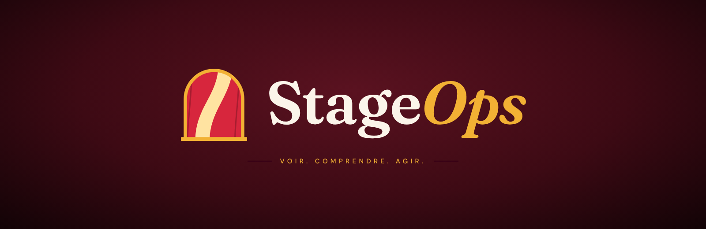
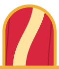
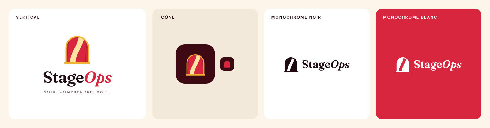
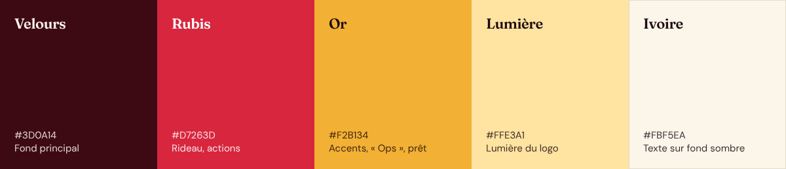
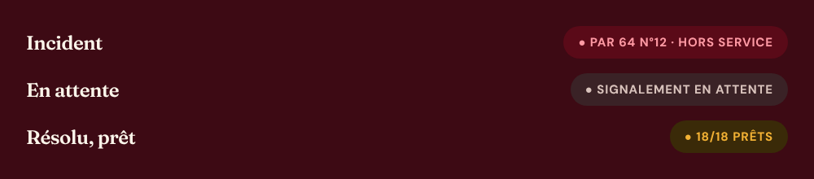
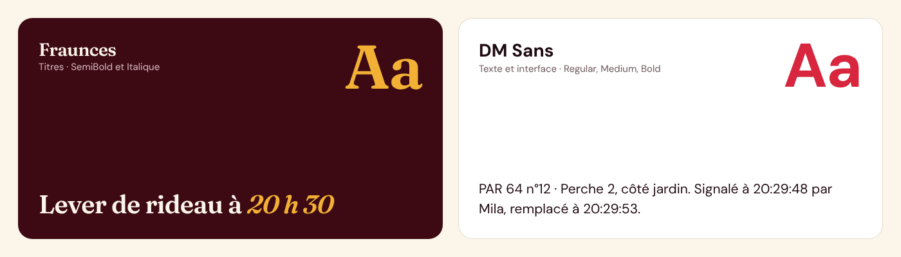

# Direction artistique — Rideau Rubis



**Rideau Rubis** est l'identité visuelle officielle de StageOps. Elle s'applique à tous les supports : application web et mobile, landing page, réseaux sociaux, présentations, vidéos et documents techniques.

> Aucune panne ne doit rester *invisible* au lever de rideau.

## Sommaire

1. [Le concept](#1-le-concept)
2. [Le logo](#2-le-logo)
3. [Déclinaisons et règles d'usage](#3-déclinaisons-et-règles-dusage)
4. [Couleurs](#4-couleurs)
5. [Couleurs d'état et accessibilité](#5-couleurs-détat-et-accessibilité)
6. [Typographie](#6-typographie)
7. [Ce qu'il faut éviter](#7-ce-quil-faut-éviter)
8. [Fichiers et tokens](#8-fichiers-et-tokens)

---

## 1. Le concept

Tout se joue dans la minute qui précède le lever de rideau : c'est le moment où chaque projecteur, chaque micro et chaque élément du décor doit être prêt. StageOps intervient précisément là. L'identité visuelle part de cette image : une salle plongée dans le noir, un rideau rouge, et la lumière qui passe entre les deux pans juste avant l'ouverture.

Ouvrir le rideau, c'est révéler ce qui était caché. Le logo raconte ainsi la même chose que la signature du projet : rendre visibles les pannes que personne ne voit.

**Signature :** *Voir. Comprendre. Agir.*

## 2. Le logo

<p align="center"></p>

Le symbole se lit en quatre éléments :

| Élément | Couleur | Sens |
| --- | --- | --- |
| **L'arche** | Or | Le cadre de scène des théâtres à l'italienne. |
| **Les rideaux** | Rubis | Le rideau rouge, symbole universel du théâtre. |
| **Le S de lumière** | Lumière | L'espace lumineux entre les rideaux dessine un **S**, comme *Stage*. |
| **Le bord de scène** | Or | La ligne dorée en bas pose et stabilise le symbole. |

**Double lecture :** on voit d'abord un rideau, puis on découvre la lettre. C'est ce qui rend le logo mémorable plutôt que simplement décoratif.

**Le logotype :** « Stage » en Fraunces SemiBold, « *Ops* » en Fraunces italique doré. L'italique met en lumière la partie technique du nom.

**Pourquoi avoir remplacé l'ancien logo ?** Le S hexagonal en dégradé violet-bleu était bien exécuté, mais il ressemblait à des centaines de logos tech et ne disait rien du théâtre. Le violet-bleu est le code couleur par défaut des SaaS : impossible de se démarquer avec. Sept pistes complètes ont été explorées (Rideau, Projecteur, Régie, Évolution, Plateau, Confettis, Pop) avant de retenir **Rideau**, retravaillée en version 2 « Rubis ».

## 3. Déclinaisons et règles d'usage



| Version | Usage |
| --- | --- |
| **Horizontale** (symbole + logotype) | Usage prioritaire : en-têtes, bannières, landing page. |
| **Verticale** (avec signature) | Formats carrés, affiches, couvertures de documents. |
| **Icône** | Icône d'application, favicon, avatar des réseaux sociaux. |
| **Monochrome noir / blanc** | Impression une couleur, fonds photo, marquage. |

**Zone de protection :** la marge autour du logo vaut **x = ½ hauteur du symbole**. Rien ne doit entrer dans cette zone.

**Tailles minimales :**

- Icône seule : **24 px**
- Logo complet (symbole + logotype) : **120 px** de large

Les formes sont volontairement simples pour que le logo reste lisible en icône de 24 px, en une seule couleur, en noir ou en blanc.

## 4. Couleurs



| Couleur | Hex | RVB | Rôle | Pourquoi |
| --- | --- | --- | --- | --- |
| **Velours** | `#3D0A14` | 61 · 10 · 20 | Fond principal | La salle dans le noir, là où travaille la régie. Un noir chaud teinté de rouge, plus riche qu'un noir pur. |
| **Rubis** | `#D7263D` | 215 · 38 · 61 | Rideau, boutons d'action | Le rideau rouge du théâtre. C'est aussi une couleur d'action, logique pour un outil qui gère des pannes. |
| **Or** | `#F2B134` | 242 · 177 · 52 | Accents, « *Ops* », statut prêt | Les dorures des théâtres à l'italienne et la lumière chaude des projecteurs. |
| **Lumière** | `#FFE3A1` | 255 · 227 · 161 | Lumière du logo | La lumière qui passe entre les rideaux. Plus douce que l'or, pour ne pas éblouir. |
| **Ivoire** | `#FBF5EA` | 251 · 245 · 234 | Texte sur fond sombre, fonds clairs | Remplace le blanc pur : plus doux, il rappelle le papier des programmes et des affiches. |

Couleurs complémentaires :

| Couleur | Hex | Usage |
| --- | --- | --- |
| **Nuit** | `#120306` | Velours plus profond, pour la vidéo et les dégradés. |
| **Encre** | `#1E0A10` | Texte sur fond clair. |
| **Rouge alerte** | `#FF5A6A` | Réservé aux pannes, toujours accompagné d'un libellé. |

**Proportions conseillées :** environ 60 % de velours, 20 % d'ivoire, 10 % de rubis, 10 % d'or et de lumière. Le rouge et l'or restent des accents : trop présents, ils perdent leur force.

## 5. Couleurs d'état et accessibilité



| État | Couleur | Exemple |
| --- | --- | --- |
| **Incident** | Rouge alerte | `PAR 64 N°12 · HORS SERVICE` |
| **En attente** | Neutre | `SIGNALEMENT EN ATTENTE` |
| **Résolu / prêt** | Or | `18/18 PRÊTS` |

**Rubis ≠ alerte.** Le rubis est la couleur de la marque (rideau, boutons). Le rouge alerte, plus clair, est réservé aux pannes et toujours accompagné d'un libellé. On ne communique jamais un état par la couleur seule.

**Pourquoi l'or et pas le vert pour « Résolu » ?** D'abord pour rester dans la palette. Surtout pour l'accessibilité : environ 8 % des hommes confondent le rouge et le vert, la paire la plus mal distinguée en cas de daltonisme (deutéranopie). Le rouge et l'or, eux, se différencient fortement par la luminosité, et l'état reste lisible.

**Contrastes des textes** (calculés selon WCAG 2.1 : 4,5:1 minimum pour un texte courant, 3:1 pour un grand titre) :

| Combinaison | Ratio | Usage autorisé |
| --- | --- | --- |
| Encre sur ivoire | 17,5:1 | Tous textes |
| Ivoire sur velours | 15,5:1 | Tous textes |
| Lumière sur velours | 13,4:1 | Tous textes |
| Or sur velours | 8,9:1 | Tous textes |
| Rouge alerte sur velours | 5,5:1 | Tous textes |
| Blanc sur rubis | 5,0:1 | Tous textes (boutons) |
| Rubis sur ivoire | 4,6:1 | Tous textes, à réserver aux accents |

## 6. Typographie



| Police | Graisses | Usage |
| --- | --- | --- |
| **[Fraunces](https://fonts.google.com/specimen/Fraunces)** | SemiBold 600, SemiBold Italique | Titres, logotype, chiffres mis en avant (compte à rebours). |
| **[DM Sans](https://fonts.google.com/specimen/DM+Sans)** | Regular 400, Medium 500, Bold 700 | Texte courant, interface, libellés, données techniques. |

- **Fraunces** est une serif à caractère, qui évoque les affiches et les programmes de théâtre. L'**italique doré** sert à mettre un mot en lumière (« Stage*Ops* », « Lever de rideau à *20 h 30* »).
- **DM Sans** est une sans-serif simple et très lisible, même en petit sur un téléphone dans le noir d'une régie.
- Les deux polices sont libres (SIL Open Font License) et disponibles sur Google Fonts et npm (`@fontsource/fraunces`, `@fontsource/dm-sans`).
- Les petites capitales espacées (`letter-spacing` ≈ 0,3 à 0,4 em) sont réservées aux surtitres et à la signature.

## 7. Ce qu'il faut éviter

- ❌ Déformer, étirer ou faire pivoter le logo.
- ❌ Changer les couleurs du symbole en dehors des versions officielles (couleur, noir, blanc).
- ❌ Poser le logo couleur sur un fond chargé ou peu contrasté : utiliser la version monochrome.
- ❌ Ajouter des ombres, contours, dégradés ou effets au logo.
- ❌ Utiliser du **vert** pour un état « prêt » ou « résolu » : c'est l'**or**.
- ❌ Utiliser le **rubis** pour signaler une panne : c'est le **rouge alerte**, avec un libellé.
- ❌ Utiliser un blanc pur ou un noir pur à la place de l'ivoire et du velours.

## 8. Fichiers et tokens

**Fichiers du dossier [`assets/`](assets/) :**

| Fichier | Contenu |
| --- | --- |
| [`logo-symbole.svg`](assets/logo-symbole.svg) | Symbole en couleur (vectoriel) |
| [`logo-symbole-noir.svg`](assets/logo-symbole-noir.svg) | Symbole monochrome noir |
| [`logo-symbole-blanc.svg`](assets/logo-symbole-blanc.svg) | Symbole monochrome blanc (pour fonds sombres ou rubis) |
| [`icone-app.svg`](assets/icone-app.svg) | Icône d'application 512 × 512 sur fond velours |
| [`banniere.png`](assets/banniere.png) | Bannière horizontale avec signature |

**Tokens CSS** à reprendre dans les projets web et mobile :

```css
:root {
  /* Palette Rideau Rubis */
  --so-velours: #3D0A14;
  --so-nuit:    #120306;
  --so-rubis:   #D7263D;
  --so-or:      #F2B134;
  --so-lumiere: #FFE3A1;
  --so-ivoire:  #FBF5EA;
  --so-encre:   #1E0A10;

  /* États */
  --so-alerte:  #FF5A6A; /* panne, toujours avec un libellé */
  --so-pret:    var(--so-or);

  /* Typographie */
  --so-font-titre: "Fraunces", Georgia, serif;
  --so-font-texte: "DM Sans", system-ui, sans-serif;
}
```

---

*Direction artistique : Mathieu Simon.*
