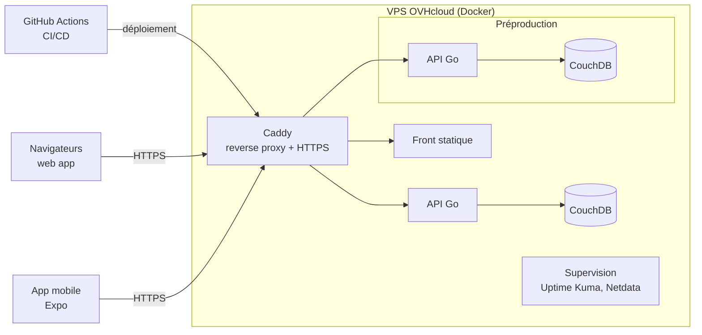

# Benchmark VPS OVHcloud

> **Recommandation :** **VPS-2 OVHcloud** à **103,82 € TTC / an** (engagement 12 mois payé d'avance).
> Le **VPS-1**, à **54,86 € TTC / an**, reste l'option minimum.

Ce benchmark sert à choisir le serveur qui héberge le backend de StageOps. Il accompagne la demande de validation et de remboursement auprès d'Epitech. Epitech demande au moins deux propositions OVH : une **minimum** et une **optimale**.

| | |
| --- | --- |
| **Auteur** | Mathieu Simon |
| **Date des relevés de prix** | 15 octobre 2026 |
| **Contact Epitech** | Romaric |
| **Objet** | VPS et nom de domaine pour l'EIP StageOps |

## Sommaire

1. [Besoins du projet](#1-besoins-du-projet)
2. [Estimation des ressources](#2-estimation-des-ressources)
3. [Gamme VPS 2027 d'OVHcloud](#3-gamme-vps-2027-dovhcloud)
4. [Proposition 1 — Minimum : VPS-1](#4-proposition-1--minimum--vps-1)
5. [Proposition 2 — Optimale : VPS-2](#5-proposition-2--optimale--vps-2-recommandée)
6. [Comparatif des coûts sur 12 mois](#6-comparatif-des-coûts-sur-12-mois)
7. [Pourquoi pas VPS-3 ou VPS-4](#7-pourquoi-pas-vps-3-ou-vps-4)
8. [Recommandation](#8-recommandation)
9. [Procédure Epitech](#9-procédure-epitech)

---

## 1. Besoins du projet

StageOps est un outil de gestion technique pour les théâtres et l'événementiel. Voici ce qui doit tourner sur le serveur :

- Le déploiement continu part de **GitHub Actions**.
- Les navigateurs et l'app mobile passent tous par **Caddy** en HTTPS, qui sert le front et l'**API Go**.
- L'API s'appuie sur **CouchDB**, qui synchronise les données de l'app hors ligne.
- L'application mobile (Expo) tourne sur les téléphones et ne consomme rien côté serveur, en dehors de la synchronisation.
- Les utilisateurs cibles sont des salles de spectacle en France : le serveur doit être hébergé dans un **datacenter français** (Gravelines, Strasbourg ou Roubaix).

## 2. Estimation des ressources

Estimations de mémoire en conditions réelles pour un projet en phase MVP / pilote, déployé en conteneurs Docker :

| Service | RAM estimée |
| --- | --- |
| Système + Docker | ~0,5 Go |
| Reverse proxy (Caddy) | ~0,1 Go |
| API Go | 0,1 à 0,3 Go |
| CouchDB (index et réplication) | 0,5 à 1,5 Go |
| Front statique | négligeable |
| Supervision (Uptime Kuma, Netdata) | 0,3 à 0,5 Go |
| Préproduction (2ᵉ API + 2ᵉ CouchDB) | 0,6 à 1,8 Go |
| **Total production + supervision** | **~1,5 à 2,9 Go** |
| **Total production + préproduction + supervision** | **~2,1 à 4,7 Go** |

CouchDB est le poste qui varie le plus : sa consommation monte pendant la construction des index et lorsque plusieurs appareils se synchronisent en même temps.

> ⚠️ Ces chiffres sont des **estimations**, pas des mesures. Ils seront à remplacer par les valeurs réelles relevées sur le serveur (`docker stats`, Netdata) une fois le backend déployé.

## 3. Gamme VPS 2027 d'OVHcloud

Tarifs officiels relevés le 15 octobre 2026 sur le catalogue OVHcloud France. Installation gratuite pour tous les modèles.

| Modèle | vCores | RAM | Stockage NVMe | Bande passante | Sans engagement (HT/mois) | Engagement 12 mois (HT/mois) |
| --- | :---: | :---: | :---: | :---: | ---: | ---: |
| VPS-1 | 2 | 4 Go | 40 Go | 500 Mbit/s | 4,49 € | 3,81 € |
| **VPS-2** | **4** | **8 Go** | **75 Go** | **1 Gbit/s** | **8,49 €** | **7,21 €** |
| VPS-3 | 6 | 12 Go | 100 Go | 2 Gbit/s | 12,24 € | 10,40 € |
| VPS-4 | 8 | 24 Go | 200 Go | 3 Gbit/s | 23,49 € | 19,96 € |

**Inclus dans tous les modèles :** trafic illimité, anti-DDoS, 1 IPv4 dédiée + IPv6, sauvegarde automatique quotidienne (dernières 24 h), accès root, console KVM, SLA 99,9 %, hébergement en France possible (GRA, SBG, RBX).

**Point important :** l'upgrade vers un modèle supérieur se fait en un clic, sans migration et sans frais. Le downgrade, lui, impose de commander un nouveau VPS et de migrer.

## 4. Proposition 1 — Minimum : VPS-1

**2 vCores · 4 Go RAM · 40 Go NVMe · 500 Mbit/s**

- ✅ Suffisant pour faire tourner la **production seule** (API + CouchDB + front + proxy), avec une marge confortable.
- ⚠️ Possible d'y ajouter une préproduction légère, mais on arrive en **limite de RAM** (jusqu'à ~4,7 Go dans le pire cas pour 4 Go disponibles) dès que CouchDB indexe ou que plusieurs appareils se synchronisent en même temps.
- ⚠️ 40 Go de disque : correct pour la base et les images Docker, plus juste pour stocker des plans 3D, des exports PDF et l'historique des sauvegardes CouchDB.

**Coût : 45,72 € HT / an, soit 54,86 € TTC** (engagement 12 mois).

## 5. Proposition 2 — Optimale : VPS-2 (recommandée)

**4 vCores · 8 Go RAM · 75 Go NVMe · 1 Gbit/s**

- ✅ Héberge **production, préproduction et supervision** sur une seule machine, avec ~3 Go de marge dans le pire cas.
- ✅ Les 4 vCores absorbent les builds et déploiements lancés par GitHub Actions sans ralentir l'environnement de démo.
- ✅ 75 Go de disque laissent la place aux assets 3D, aux exports et à plusieurs semaines de sauvegardes.
- ✅ Couvre toute la roadmap (MVP en décembre, temps réel en mars, pilote en salle partenaire en mai) sans changer de machine.

**Coût : 86,52 € HT / an, soit 103,82 € TTC** (engagement 12 mois).

## 6. Comparatif des coûts sur 12 mois

| | VPS-1 (minimum) | VPS-2 (optimal) |
| --- | ---: | ---: |
| Sans engagement (12 × mensuel) | 53,88 € HT / 64,66 € TTC | 101,88 € HT / 122,26 € TTC |
| Engagement 6 mois (× 2) | 51,12 € HT / 61,34 € TTC | 96,72 € HT / 116,06 € TTC |
| **Engagement 12 mois, payé d'avance** | **45,72 € HT / 54,86 € TTC** | **86,52 € HT / 103,82 € TTC** |
| Économie 12 mois vs sans engagement | 15 % | 15 % |

**Option recommandée pour la production**, quel que soit le modèle : **sauvegarde automatique Premium** (restauration sur 7 jours glissants), à partir de 1,10 € HT/mois, soit ~15,84 € TTC/an.

Le choix de l'engagement 12 mois payé d'avance se justifie aussi par le contexte : OVHcloud a déjà relevé ses prix VPS deux fois en 2026 à cause de la hausse du coût de la RAM et des disques. Payer l'année d'avance fige le tarif.

## 7. Pourquoi pas VPS-3 ou VPS-4

- **VPS-3** (6 vCores, 12 Go, 149,76 € TTC/an) : la RAM supplémentaire ne servirait pas avant une vraie montée en charge avec plusieurs salles clientes, ce qui n'est pas prévu pendant l'EIP.
- **VPS-4** (8 vCores, 24 Go, 287,42 € TTC/an) : dimensionné pour des charges de production importantes. Surdimensionné pour notre usage.

Comme l'upgrade est instantané et gratuit, il n'y a aucune raison de surdimensionner dès maintenant.

## 8. Recommandation

| Paramètre | Choix |
| --- | --- |
| **Offre** | VPS-2 2027 |
| **Datacenter** | Gravelines (GRA) ou Strasbourg (SBG) |
| **Système** | Debian 12 – Docker (image proposée par OVH) ou Ubuntu 24.04 |
| **Engagement** | 12 mois, payé d'avance |
| **Coût** | **103,82 € TTC / an** |
| **Avec sauvegarde Premium** | **~119,66 € TTC / an** |

Si le VPS-2 est jugé trop large, le **VPS-1** (54,86 € TTC/an) reste viable pour la production seule, avec un upgrade possible vers le VPS-2 en un clic si la préproduction ou CouchDB saturent la mémoire.

**Nom de domaine :** à demander dans la même validation, pour exposer l'API, le front et la préproduction en HTTPS (ex. `app.`, `api.`, `staging.`). Le prix dépend de l'extension choisie et sera indiqué dans la demande.

## 9. Procédure Epitech

Les frais de VPS ne sont pas pris en charge automatiquement. La procédure est la suivante :

1. Soumettre ce benchmark avec au moins deux propositions OVH (minimum et optimale).
2. Faire valider la dépense via une demande d'aide auprès d'Epitech (le nom de domaine peut être validé dans la même demande).
3. Avancer le paiement.
4. Se faire rembourser sur justificatif.

## Sources

- [OVHcloud — page VPS](https://www.ovhcloud.com/fr/vps/)
- [OVHcloud — catalogue public VPS (API, tarifs FR)](https://eu.api.ovh.com/1.0/order/catalog/public/vps?ovhSubsidiary=FR)
- [OVHcloud Blog — lancement de la gamme VPS 2027](https://blog.ovhcloud.com/vps-2027-fr/)
- [JustGeek — nouvelle hausse des prix OVHcloud en 2026](https://www.justgeek.fr/hausse-prix-ovhcloud-2026-156725/)
